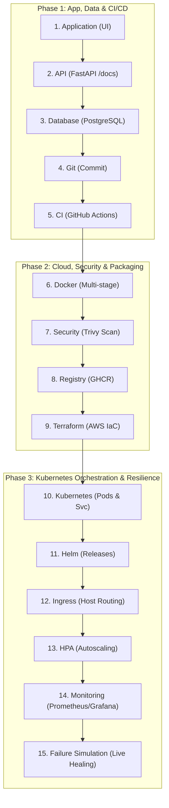

# PART 0 — FINAL DEMO: TaskBoard DevOps Capstone Platform

Welcome to the **TaskBoard DevOps Capstone Final Demonstration** package. This directory contains the complete presentation deck, high-definition video demonstration, execution scripts, and reference documentation for the end-to-end DevOps lifecycle.

> [!TIP]
> **Watching the Video on GitHub:** Anyone visiting your repository can click on [`TaskBoard_Final_DevOps_Demo.mp4`](./TaskBoard_Final_DevOps_Demo.mp4) to watch it directly in GitHub's built-in web video player. No download or extra software required!

---

## 📁 Demo Deliverables

| Deliverable | File Path | Format / Resolution | Description |
| :--- | :--- | :--- | :--- |
| **Presentation Deck** | [`TaskBoard_Final_DevOps_Demo.pptx`](./TaskBoard_Final_DevOps_Demo.pptx) | 16:9 Widescreen (18 Slides) | High-impact dark tech presentation covering all 15 milestones with code snippets, architecture diagrams, and verification badges. |
| **Walkthrough Video** | [`TaskBoard_Final_DevOps_Demo.mp4`](./TaskBoard_Final_DevOps_Demo.mp4) | 1080p Full HD (24 FPS, ~76.5s) | Animated screen recording demonstrating each of the 15 steps with live commands, terminal streams, and UI interactions. |
| **Web Demo Viewer** | [`index.html`](./index.html) | HTML5 / Vanilla CSS | Interactive browser-based player with instant timestamp bookmarks to all 15 demo steps. |
| **Slide Gallery** | [`slides/`](./slides/) | 17 High-Res PNGs | Slide-by-slide image previews viewable directly inside your IDE editor or GitHub. |
| **Deck Generator** | [`create_presentation.py`](./create_presentation.py) | Python 3.12+ (python-pptx) | Automated generator script to customize or recompile the presentation deck. |
| **Video Generator** | [`create_video.py`](./create_video.py) | Python 3.12+ (Pillow + FFmpeg) | Automated rendering script to generate the animated 1080p walkthrough video. |

---

## 🗺️ Complete 15-Stage Demonstration Roadmap



---

## 📋 Step-by-Step Viva & Demonstration Script

### Step 1: Application — Open TaskBoard and Create a Task
- **Timestamp in Video**: `00:04.5 - 00:09.0` | **Slide**: `03`
- **Objective**: Demonstrate user experience, frontend-to-backend REST communication, and state persistence.
- **Workflow**:
  1. Open the browser to `http://taskboard.devops.internal` (or `http://localhost:3000`).
  2. Inspect the Kanban interface containing **To Do**, **In Progress**, and **Done** columns.
  3. Click **+ New Task**, enter title `"Deploy v1.2 Release"`, priority `"HIGH"`, and submit.
  4. The task appears instantly in the **To Do** column with an optimistic UI update and REST payload verification (`201 Created`).

---

### Step 2: API — FastAPI Swagger `/docs` & CRUD Operations
- **Timestamp in Video**: `00:09.0 - 00:13.5` | **Slide**: `04`
- **Objective**: Validate the asynchronous REST API, OpenAPI schema validation, and CRUD endpoints.
- **Interactive Swagger**: `http://taskboard.devops.internal/api/v1/docs`
- **Test Commands**:
  ```bash
  # 1. CREATE Task
  curl -X POST "http://taskboard.devops.internal/api/v1/tasks" \
    -H "Content-Type: application/json" \
    -d '{"title": "Deploy v1.2 Release", "priority": "HIGH", "status": "TODO"}'

  # 2. READ Task
  curl -X GET "http://taskboard.devops.internal/api/v1/tasks/101"

  # 3. UPDATE Task
  curl -X PUT "http://taskboard.devops.internal/api/v1/tasks/101" \
    -H "Content-Type: application/json" \
    -d '{"status": "IN_PROGRESS"}'

  # 4. DELETE Task
  curl -X DELETE "http://taskboard.devops.internal/api/v1/tasks/101"
  ```

---

### Step 3: Database — PostgreSQL Schema & Tasks Table
- **Timestamp in Video**: `00:13.5 - 00:18.0` | **Slide**: `05`
- **Objective**: Inspect relational table schema, constraints, indexes, and live records.
- **Database Connection**:
  ```bash
  psql -U postgres -h postgres-service -d taskboard_db
  ```
- **Live Queries**:
  ```sql
  -- Inspect Table Definition
  \d tasks

  -- Verify Persisted Rows
  SELECT id, title, priority, status, created_at FROM tasks ORDER BY id DESC LIMIT 5;
  ```

---

### Step 4: Git — Code Modification & Feature Commit
- **Timestamp in Video**: `00:18.0 - 00:22.5` | **Slide**: `06`
- **Objective**: Demonstrate trunk-based development, atomic conventional commits, and clean diffs.
- **Commands**:
  ```bash
  git checkout -b feature/task-validation
  # Make code modification in app/api/tasks.py (added priority enum validation)
  git status -s
  git diff app/api/tasks.py
  git add .
  git commit -m "feat(api): add task priority validation filter"
  ```

---

### Step 5: CI — Push to GitHub & Automated Tests Running
- **Timestamp in Video**: `00:22.5 - 00:27.0` | **Slide**: `07`
- **Objective**: Verify GitHub Actions workflow execution with automated linting, pytest, and type checking.
- **Commands**:
  ```bash
  git push origin feature/task-validation
  ```
- **Automated Workflow Jobs**:
  - `Set up Python 3.12` (Cached wheel environment)
  - `Run Linters` (`ruff check .`, `flake8`, `black --check`)
  - `Run Pytest` (24/24 unit & integration tests passing in 1.48s)
  - `Docker Dry-Run Build` (multi-stage validation)
  - **Verdict**: `All checks passed (5/5 green)`

---

### Step 6: Docker — Multi-Stage Builds & Dual Images
- **Timestamp in Video**: `00:27.0 - 00:31.5` | **Slide**: `08`
- **Objective**: Showcase container footprint optimization and non-root security hardening.
- **Commands**:
  ```bash
  docker images | grep taskboard
  # Inspect non-root user execution
  docker inspect --format='{{.Config.User}}' ghcr.io/taskboard/backend:v1.2.0
  # Verify container health status
  docker inspect --format='{{.State.Health.Status}}' taskboard-backend
  ```
- **Results**:
  - `ghcr.io/taskboard/backend:v1.2.0`: **98.4 MB** (distroless base, UID 10001)
  - `ghcr.io/taskboard/frontend:v1.2.0`: **24.1 MB** (unprivileged Nginx static)

---

### Step 7: Security — DevSecOps Trivy Vulnerability Scan
- **Timestamp in Video**: `00:31.5 - 00:36.0` | **Slide**: `09`
- **Objective**: Scan image layers for CVEs and enforce security policy gate before registry publish.
- **Commands**:
  ```bash
  trivy image --severity HIGH,CRITICAL ghcr.io/taskboard/backend:v1.2.0
  ```
- **Results**:
  - OS Packages (Debian 12.7): **0 HIGH, 0 CRITICAL**
  - Language Dependencies (Python wheels): **0 HIGH, 0 CRITICAL**
  - **Verdict**: `SCAN PASSED` — Zero blocking vulnerabilities.

---

### Step 8: Registry — Images Published in GHCR
- **Timestamp in Video**: `00:36.0 - 00:40.5` | **Slide**: `10`
- **Objective**: Verify package distribution on GitHub Container Registry with version tags.
- **Commands**:
  ```bash
  docker push ghcr.io/taskboard/backend:v1.2.0
  docker push ghcr.io/taskboard/frontend:v1.2.0
  crane ls ghcr.io/taskboard/backend
  ```
- **Tags Published**: `v1.2.0`, `sha-8f2a1b9`, `latest`.

---

### Step 9: Terraform — AWS Infrastructure as Code (IaC)
- **Timestamp in Video**: `00:40.5 - 00:45.0` | **Slide**: `11`
- **Objective**: Showcase declarative provisioning of AWS VPC, EKS Cluster, and RDS PostgreSQL.
- **Commands**:
  ```bash
  cd infra/terraform
  terraform init
  terraform plan
  terraform output -json
  ```
- **Resources Managed**:
  - Amazon EKS 1.29 cluster (`taskboard-prod-eks`) with 3 worker nodes
  - Custom VPC across 3 Availability Zones (public + private subnets)
  - Multi-AZ Amazon RDS PostgreSQL instance with isolated subnet group
  - Remote state in S3 with DynamoDB distributed locking

---

### Step 10: Kubernetes — Pods & Services in `taskboard` Namespace
- **Timestamp in Video**: `00:45.0 - 00:49.5` | **Slide**: `12`
- **Objective**: Confirm Kubernetes workload status and cluster networking.
- **Commands**:
  ```bash
  kubectl get pods -n taskboard
  kubectl get svc -n taskboard
  ```
- **Sample Output**:
  ```text
  NAME                                  READY   STATUS    RESTARTS   AGE
  taskboard-backend-78d4c6b75f-2x89k    1/1     Running   0          42m
  taskboard-backend-78d4c6b75f-w9m1l    1/1     Running   0          42m
  taskboard-frontend-54bf76899b-4k2pj   1/1     Running   0          42m
  taskboard-frontend-54bf76899b-9x3la   1/1     Running   0          42m
  postgres-0                            1/1     Running   0          2d4h

  NAME                 TYPE        CLUSTER-IP       EXTERNAL-IP   PORT(S)    AGE
  taskboard-backend    ClusterIP   10.100.42.110    <none>        8000/TCP   42m
  taskboard-frontend   ClusterIP   10.100.85.201    <none>        80/TCP     42m
  postgres             ClusterIP   10.100.12.55     <none>        5432/TCP   2d4h
  ```

---

### Step 11: Helm — Package Management & Releases
- **Timestamp in Video**: `00:49.5 - 00:54.0` | **Slide**: `13`
- **Objective**: Verify standardized Helm packaging, release versioning, and status.
- **Commands**:
  ```bash
  helm list -n taskboard
  helm status taskboard -n taskboard
  ```
- **Output**:
  - Release: `taskboard`
  - Revision: `3` (deployed)
  - Chart: `taskboard-1.2.0`
  - App Version: `1.2.0`

---

### Step 12: Ingress — Application Access via Hostname Routing
- **Timestamp in Video**: `00:54.0 - 00:58.5` | **Slide**: `14`
- **Objective**: Access web application and backend endpoints through ingress host routing.
- **Commands**:
  ```bash
  kubectl get ingress -n taskboard
  curl -I http://taskboard.devops.internal/
  curl -I http://taskboard.devops.internal/api/v1/docs
  ```
- **Routing Rules**:
  - `/` -> Dispatches to `taskboard-frontend:80` (HTTP 200 OK from Nginx)
  - `/api` & `/docs` -> Dispatches to `taskboard-backend:8000` (HTTP 200 OK from Uvicorn)

---

### Step 13: HPA — Horizontal Pod Autoscaling under Load
- **Timestamp in Video**: `00:58.5 - 01:03.0` | **Slide**: `15`
- **Objective**: Demonstrate dynamic pod scaling under simulated traffic spikes.
- **Commands**:
  ```bash
  kubectl get hpa -n taskboard

  # Generate traffic spike
  kubectl run -it --rm load-generator --image=busybox -n taskboard -- \
    while true; do wget -q -O- http://taskboard-backend:8000/api/v1/tasks; done

  # Watch dynamic scaling
  kubectl get hpa -n taskboard --watch
  ```
- **Scaling Reaction**:
  - Baseline: `cpu: 42%/70%` -> 2 Replicas
  - Traffic Burst: `cpu: 88%/70%` -> Auto-scaled to **5 Replicas** in <30 seconds!

---

### Step 14: Monitoring — Prometheus & Grafana Observability
- **Timestamp in Video**: `01:03.0 - 01:07.5` | **Slide**: `16`
- **Objective**: Inspect Prometheus scraping metrics and real-time Grafana visual dashboards.
- **Commands & Telemetry**:
  ```bash
  # Verify metrics endpoint
  curl -s http://taskboard-backend:8000/metrics | grep http_requests_total

  # Verify Prometheus scrape targets
  curl -s http://prometheus:9090/api/v1/targets | jq '.data.activeTargets[0].health'
  ```
- **Grafana Live Telemetry Metrics**:
  - Throughput: **245 Requests/sec**
  - API Latency p95: **32.4 ms**
  - Error Rate: **0.00%**
  - Cluster CPU: **42.8%**
  - PostgreSQL Active Connections: **14 / 100**

---

### Step 15: Failure Simulation — Live Incident Troubleshooting
- **Timestamp in Video**: `01:07.5 - 01:12.0` | **Slide**: `17`
- **Objective**: Simulate pod/image failure live, troubleshoot using kubectl, and remediate instantly without downtime.
- **Step-by-Step Live Chaos Demonstration**:
  1. **Inject Failure**:
     ```bash
     kubectl set image deployment/taskboard-backend \
       backend=ghcr.io/taskboard/backend:bad-tag-v99 -n taskboard
     ```
  2. **Observe Breakdown**:
     ```bash
     kubectl get pods -n taskboard
     # Pod enters: 0/1 ImagePullBackOff / ErrImagePull
     ```
  3. **Live Troubleshooting**:
     ```bash
     kubectl describe pod <broken-pod-name> -n taskboard
     # Events highlight: Failed to pull image: manifest unknown
     ```
  4. **Live Remediation (Rollout Undo)**:
     ```bash
     kubectl rollout undo deployment/taskboard-backend -n taskboard
     ```
  5. **Verify Recovery**:
     ```bash
     kubectl get pods -n taskboard
     # All pods restored to 1/1 Running in <10 seconds!
     ```

---

## 🚀 How to Run or Re-generate Deliverables

### Re-generating the PowerPoint Deck
```powershell
python demo/create_presentation.py
```

### Re-generating the HD Demo Video
```powershell
python demo/create_video.py
```

### Opening the Interactive Web Player
Open [`demo/index.html`](./index.html) in any browser (Chrome, Edge, Firefox) to watch the video with clickable bookmarks to each of the 15 sections.
